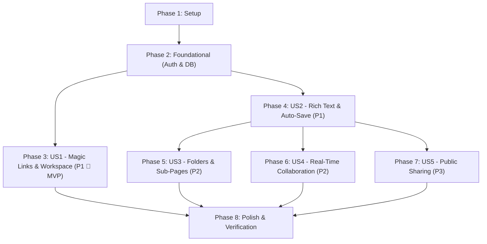

# Implementation Tasks: Collaborative Notebook Workspace

**Feature Branch**: `001-collaborative-notebook` | **Date**: 2026-10-15 | **Spec**: [spec.md](./spec.md) | **Plan**: [plan.md](./plan.md)

---

## Phase 1: Setup (Shared Infrastructure)

**Purpose**: Project initialization, dependency installation, and multi-database infrastructure configuration.

- [x] T001 Add `gem "lexxy"` and development dependency `gem "hotwire-spark"` to Gemfile and run `bundle install`
  - *Acceptance Criteria*: `Gemfile` contains `gem "lexxy"` and group `:development` contains `gem "hotwire-spark"`; `bundle install` completes with exit code 0.
  - *Validation*: `bundle exec gem list | grep -E "lexxy|hotwire-spark"`

- [ x ] T002 [P] Configure multi-database SQLite3 and Solid Cable in config/database.yml and config/cable.yml
  - *Acceptance Criteria*: `config/database.yml` defines separate SQLite database files for `primary` (`storage/development.sqlite3`), `cable` (`storage/development_cable.sqlite3`), `cache` (`storage/development_cache.sqlite3`), and `queue` (`storage/development_queue.sqlite3`) with WAL mode; `config/cable.yml` sets development adapter to `solid_cable` connecting to `cable` database.
  - *Validation*: `bin/rails db:prepare`

- [ x ] T003 [P] Configure Lexxy and Stimulus pins in config/importmap.rb and app/javascript/application.js
  - *Acceptance Criteria*: `config/importmap.rb` pins `lexxy` and `@rails/activestorage`; `app/javascript/application.js` imports `lexxy` without JavaScript syntax or bundling errors.
  - *Validation*: `bin/rails importmap:verify`

---

## Phase 2: Foundational (Blocking Prerequisites)

**Purpose**: Core user authentication schemas, session models, and base application layouts.

**⚠️ CRITICAL**: No user story work can begin until this foundational phase is complete.

- [ ] T004 Create database migration for users, sessions, and oauth_identities in db/migrate/
  - *Acceptance Criteria*: Creates `users` table with `email_address` (string, not null, unique index), `name` (string, not null, max length 100), `password_digest` (string, nullable), `last_sign_in_at` (datetime, nullable); creates `sessions` table with `user_id` (bigint, not null, indexed, foreign key to users), `ip_address` (string), `user_agent` (string); creates `oauth_identities` table with `user_id` (bigint, not null, indexed), `provider` (string, not null), `uid` (string, not null), compound unique index on `[:provider, :uid]`.
  - *Validation*: `bin/rails db:migrate`

- [ ] T005 [P] Implement base User, Session, and Current models in app/models/user.rb, app/models/session.rb, and app/models/current.rb
  - *Acceptance Criteria*: `User` has `has_many :sessions, dependent: :destroy`, validates `name` presence and max length 100, validates `email_address` presence, uniqueness case-insensitive, and format with `URI::MailTo::EMAIL_REGEXP`; `Session` belongs to `User`; `Current` declares `attribute :user, :session`.
  - *Validation*: `bin/rails test test/models/`

- [ ] T006 [P] Implement authentication controller concern in app/controllers/concerns/authentication.rb
  - *Acceptance Criteria*: Defines `require_authentication`, `resume_session`, `start_new_session_for(user)`, and `terminate_session` storing signed session id in `cookies.signed.permanent[:session_id]`; included in `ApplicationController`.
  - *Validation*: Unit test verification in controller helper test.

- [ ] T007 Configure development mailer delivery and base layout in config/environments/development.rb and app/views/layouts/application.html.erb
  - *Acceptance Criteria*: `config/environments/development.rb` sets `config.action_mailer.delivery_method = :test` or `:letter_opener`; `app/views/layouts/application.html.erb` includes Tailwind CSS links, Hotwire Turbo tags, flash message display partial, and current user navigation header.
  - *Validation*: Start `bin/rails server` and verify HTTP 200 response.

**Checkpoint**: Foundation ready — User Story implementation can proceed.

---

## Phase 3: User Story 1 - User Authentication & Personal Notebook Setup (Priority: P1) 🎯 MVP

**Goal**: Provide secure user registration, passwordless Magic Link authentication with 15-minute expiration, Google OAuth2 login, and session management.

**Independent Test**: Register or submit email at `/magic_links/new`, receive tokenized URL in mailer, open verification link, verify session creation and redirection to `/dashboard`, and confirm sign-out terminates session.

### Tests for User Story 1 ⚠️

- [ ] T008 [P] [US1] Unit and request tests for Magic Link generation and session verification in test/models/user_test.rb and test/controllers/magic_links_controller_test.rb
  - *Acceptance Criteria*: Verifies `user.generate_token_for(:magic_link)` produces a valid token, expires after 15 minutes, invalidates upon `last_sign_in_at` change; `GET /magic_links/verify` with valid token signs in user, and invalid token returns 302 with alert.
  - *Validation*: `bin/rails test test/models/user_test.rb test/controllers/magic_links_controller_test.rb`

- [ ] T009 [P] [US1] System test for end-to-end Magic Link login flow in test/system/authentication_test.rb
  - *Acceptance Criteria*: Capybara system test simulates entering email, opening email link, arriving at dashboard, and signing out.
  - *Validation*: `bin/rails test:system test/system/authentication_test.rb`

### Implementation for User Story 1

- [ ] T010 [US1] Implement generates_token_for magic_link in app/models/user.rb
  - *Acceptance Criteria*: `User` model defines `generates_token_for :magic_link, expires_in: 15.minutes { last_sign_in_at }`.
  - *Validation*: `bin/rails runner "u = User.first; puts u.generate_token_for(:magic_link)"`

- [ ] T011 [US1] Implement MagicLinkMailer in app/mailers/magic_link_mailer.rb and app/views/magic_link_mailer/sign_in_link.html.erb
  - *Acceptance Criteria*: `MagicLinkMailer#sign_in_link(user, token)` builds email with subject "Seu link mágico de acesso ao NoteKami" and action button linking to `verify_magic_link_url(token: token)`.
  - *Validation*: `bin/rails test test/mailers/magic_link_mailer_test.rb`

- [ ] T012 [US1] Implement MagicLinksController in app/controllers/magic_links_controller.rb and app/views/magic_links/new.html.erb
  - *Acceptance Criteria*: `new` renders email input; `create` finds or creates user by normalized email, generates token, sends mailer via `deliver_later` with Solid Queue, and renders confirmation; `verify` finds user by token, updates `last_sign_in_at`, establishes session, and redirects to dashboard.
  - *Validation*: `bin/rails test test/controllers/magic_links_controller_test.rb`

- [ ] T013 [P] [US1] Implement Google OAuth flow in app/controllers/oauth_controller.rb and app/models/oauth_identity.rb
  - *Acceptance Criteria*: `GET /auth/google` redirects to Google OAuth endpoint with secure state token; `GET /auth/google/callback` exchanges authorization code, verifies identity, creates or links `OAuthIdentity`, calls `start_new_session_for`, and redirects to dashboard.
  - *Validation*: `bin/rails test test/controllers/oauth_controller_test.rb`

- [ ] T014 [US1] Implement SessionsController in app/controllers/sessions_controller.rb and app/views/sessions/new.html.erb
  - *Acceptance Criteria*: `new` renders login options (Magic Link and Google OAuth button); `destroy` terminates session via `terminate_session` and redirects to login with flash notice.
  - *Validation*: `bin/rails test test/controllers/sessions_controller_test.rb`

- [ ] T015 [US1] Implement DashboardController in app/controllers/dashboard_controller.rb and app/views/dashboard/index.html.erb
  - *Acceptance Criteria*: `index` action enforces `require_authentication`, lists user's recent notes, and provides quick actions for creating notes and folders.
  - *Validation*: Open `http://localhost:3000/dashboard` in browser as authenticated user.

**Checkpoint**: User Story 1 (MVP) is completely functional and testable independently.

---

## Phase 4: User Story 2 - Rich Text Note Creation with Debounced Auto-Save (Priority: P1)

**Goal**: Deliver rich text note drafting with Action Text / Lexxy and automatic background persistence with a 750ms debounce and real-time status indicators.

**Independent Test**: Create a note, format headings, bold text, code blocks in the Lexxy editor, pause typing, observe the auto-save indicator change from "Salvando..." to "✓ Salvo", and reload the page to confirm complete content preservation.

### Tests for User Story 2 ⚠️

- [ ] T016 [P] [US2] Unit and request tests for Note CRUD and debounced auto-save in test/models/note_test.rb and test/controllers/notes_controller_test.rb
  - *Acceptance Criteria*: Verifies `Note` validates title presence and maximum length 200; `PATCH /notes/:id` with Turbo Stream and JSON formats updates title and Action Text content and returns 200 OK.
  - *Validation*: `bin/rails test test/models/note_test.rb test/controllers/notes_controller_test.rb`

- [ ] T017 [P] [US2] System test for Lexxy editor and auto-save persistence in test/system/notes_editing_test.rb
  - *Acceptance Criteria*: Types formatted content in Lexxy editor canvas, waits 800ms, verifies "✓ Salvo" appears, refreshes page, and asserts content is restored.
  - *Validation*: `bin/rails test:system test/system/notes_editing_test.rb`

### Implementation for User Story 2

- [ ] T018 [US2] Create database migration for notes and Action Text in db/migrate/
  - *Acceptance Criteria*: Runs `bin/rails action_text:install` to create rich text tables; creates `notes` table with `user_id` (bigint, not null, indexed, foreign key to users), `title` (string, not null, default: "Sem título", limit: 200), `public_share_enabled` (boolean, not null, default: false, indexed), `public_share_token` (string, nullable, unique index).
  - *Validation*: `bin/rails db:migrate`

- [ ] T019 [US2] Implement Note model in app/models/note.rb
  - *Acceptance Criteria*: `Note` has `belongs_to :user`, `has_rich_text :content`, validates `title` presence and maximum length 200, defines `scope :recent, -> { order(updated_at: :desc) }`.
  - *Validation*: `bin/rails test test/models/note_test.rb`

- [ ] T020 [US2] Implement NotesController in app/controllers/notes_controller.rb
  - *Acceptance Criteria*: Enforces `require_authentication`; `create` instantiates new note and redirects to `edit`; `edit` loads note for current user or collaborator; `update` updates note attributes, responding to `turbo_stream` and `json` with updated timestamp.
  - *Validation*: `bin/rails test test/controllers/notes_controller_test.rb`

- [ ] T021 [US2] Implement Stimulus auto-save controller in app/javascript/controllers/auto_save_controller.js
  - *Acceptance Criteria*: Listens to input events on title and Lexxy editor; arms a 750ms debounce timer; displays "Salvando..." during fetch `PATCH /notes/:id` request; transitions status element to "✓ Salvo às HH:MM:SS" on success; handles Cmd+S / Ctrl+S to save immediately.
  - *Validation*: Test typing in editor canvas and check browser console network panel for debounced PATCH requests.

- [ ] T022 [US2] Build note editing views and Lexxy form in app/views/notes/edit.html.erb and app/views/notes/_form.html.erb
  - *Acceptance Criteria*: Renders responsive note canvas with title input, status badge container (`#auto_save_status`), and `rich_text_area :content` utilizing Lexxy editor.
  - *Validation*: Open note edit page in browser, type content, and verify editor formatting and auto-save indicator.

**Checkpoint**: User Stories 1 and 2 are fully functional and independently testable.

---

## Phase 5: User Story 3 - Hierarchical Organization with Folders and Nested Sub-Pages (Priority: P2)

**Goal**: Organize documents with expandable folders and nested sub-pages, preventing circular parent-child references.

**Independent Test**: Create a folder in the sidebar, create a note inside it, create a child sub-page under that note, and navigate the resulting tree hierarchy in the sidebar.

### Tests for User Story 3 ⚠️

- [ ] T023 [P] [US3] Unit and request tests for Folder hierarchy and cycle prevention in test/models/folder_test.rb and test/controllers/folders_controller_test.rb
  - *Acceptance Criteria*: Tests that setting a folder's `parent_folder_id` to itself or a descendant fails validation; tests folder creation and note assignment via `POST /folders`.
  - *Validation*: `bin/rails test test/models/folder_test.rb test/controllers/folders_controller_test.rb`

- [ ] T024 [P] [US3] System test for folder creation and sub-page nesting in test/system/note_organization_test.rb
  - *Acceptance Criteria*: Creates folder, moves note into folder, creates sub-page via "Adicionar Subpágina", asserts tree hierarchy in sidebar.
  - *Validation*: `bin/rails test:system test/system/note_organization_test.rb`

### Implementation for User Story 3

- [ ] T025 [US3] Create database migration for folders and note hierarchy fields in db/migrate/
  - *Acceptance Criteria*: Creates `folders` table with `user_id` (bigint, not null, indexed), `parent_folder_id` (bigint, nullable, indexed), `name` (string, not null, limit: 80); adds `folder_id` (bigint, nullable, indexed) and `parent_note_id` (bigint, nullable, indexed) to `notes` table.
  - *Validation*: `bin/rails db:migrate`

- [ ] T026 [US3] Implement Folder model with cycle validation in app/models/folder.rb
  - *Acceptance Criteria*: `Folder` has `belongs_to :user`, `belongs_to :parent_folder, class_name: "Folder", optional: true`, `has_many :sub_folders, class_name: "Folder", foreign_key: :parent_folder_id, dependent: :destroy`, `has_many :notes, dependent: :nullify`; validates `name` presence and maximum length 80; custom validation `prevent_circular_nesting`.
  - *Validation*: `bin/rails test test/models/folder_test.rb`

- [ ] T027 [US3] Update Note model with sub-page associations and cycle validation in app/models/note.rb
  - *Acceptance Criteria*: `Note` adds `belongs_to :folder, optional: true`, `belongs_to :parent_note, class_name: "Note", optional: true`, `has_many :sub_pages, class_name: "Note", foreign_key: :parent_note_id, dependent: :destroy`; custom validation `prevent_circular_nesting` ensuring note cannot be its own ancestor.
  - *Validation*: `bin/rails test test/models/note_test.rb`

- [ ] T028 [US3] Implement FoldersController in app/controllers/folders_controller.rb
  - *Acceptance Criteria*: Enforces `require_authentication`; `create` creates folder and responds with Turbo Stream adding folder to sidebar tree; `destroy` removes folder and re-renders sidebar tree.
  - *Validation*: `bin/rails test test/controllers/folders_controller_test.rb`

- [ ] T029 [US3] Add sub-pages action to NotesController in app/controllers/notes_controller.rb
  - *Acceptance Criteria*: `POST /notes/:id/sub_pages` creates child note with `parent_note_id = params[:id]` and redirects to edit child note.
  - *Validation*: `bin/rails test test/controllers/notes_controller_test.rb`

- [ ] T030 [US3] Build sidebar tree partial and tree Stimulus controller in app/views/shared/_sidebar_tree.html.erb and app/javascript/controllers/tree_controller.js
  - *Acceptance Criteria*: Recursive ERB partial renders collapsible folders, notes, and nested sub-pages; Stimulus controller manages toggle expansion states with animation.
  - *Validation*: Open workspace in browser and test expanding/collapsing folder and sub-page nodes.

**Checkpoint**: User Stories 1, 2, and 3 work seamlessly and independently.

---

## Phase 6: User Story 4 - Real-Time Collaborative Editing & Presence (Priority: P2)

**Goal**: Enable real-time peer collaboration, collaborator invitation via email, active presence indicator badges, and live content broadcasts over Solid Cable.

**Independent Test**: Open the same note in two different authenticated browser sessions, invite the second user as collaborator, type in one session, and verify that active presence avatars and real-time updates render in the second session.

### Tests for User Story 4 ⚠️

- [ ] T031 [P] [US4] Unit and channel tests for NoteCollaborator and NoteChannel in test/models/note_collaborator_test.rb and test/channels/note_channel_test.rb
  - *Acceptance Criteria*: Tests that owner cannot be added as collaborator; tests `NoteChannel` subscription authorization and presence broadcast (`appear`/`disappear`).
  - *Validation*: `bin/rails test test/models/note_collaborator_test.rb test/channels/note_channel_test.rb`

- [ ] T032 [P] [US4] System test for multi-user collaboration and presence in test/system/collaborative_presence_test.rb
  - *Acceptance Criteria*: Opens two browser sessions with different users on the same note, asserts avatar presence renders for both users.
  - *Validation*: `bin/rails test:system test/system/collaborative_presence_test.rb`

### Implementation for User Story 4

- [ ] T033 [US4] Create database migration for note_collaborators in db/migrate/
  - *Acceptance Criteria*: Creates `note_collaborators` table with `note_id` (bigint, not null, indexed), `user_id` (bigint, not null, indexed), `role` (string, not null, default: "editor"), unique compound index on `[:note_id, :user_id]`.
  - *Validation*: `bin/rails db:migrate`

- [ ] T034 [US4] Implement NoteCollaborator model in app/models/note_collaborator.rb
  - *Acceptance Criteria*: `belongs_to :note`, `belongs_to :user`, validates `role` inclusion in `["editor", "viewer"]`, custom validation preventing note owner from being collaborator.
  - *Validation*: `bin/rails test test/models/note_collaborator_test.rb`

- [ ] T035 [US4] Implement NoteChannel with presence tracking in app/channels/note_channel.rb
  - *Acceptance Criteria*: Verifies authorization on `subscribed`; tracks presence via Solid Cable; handles `appear` and `disappear` actions, broadcasting `presence_update` and `content_updated` messages to `note_#{note.id}` stream.
  - *Validation*: `bin/rails test test/channels/note_channel_test.rb`

- [ ] T036 [US4] Implement CollaboratorsController in app/controllers/collaborators_controller.rb
  - *Acceptance Criteria*: `create` finds user by email, creates `NoteCollaborator`, and returns Turbo Stream; `destroy` revokes access and broadcasts `access_revoked` event via Solid Cable.
  - *Validation*: `bin/rails test test/controllers/collaborators_controller_test.rb`

- [ ] T037 [US4] Implement Stimulus presence controller in app/javascript/controllers/presence_controller.js
  - *Acceptance Criteria*: Connects to `NoteChannel` via Action Cable consumer; manages `appear`/`disappear` hooks; renders live avatar badges in note header; listens for remote updates.
  - *Validation*: Open note in two browser tabs and check avatar stack updates in header.

- [ ] T038 [US4] Build collaborator drawer and presence avatar partials in app/views/notes/_collaborators_drawer.html.erb and app/views/notes/_presence_avatars.html.erb
  - *Acceptance Criteria*: Header displays connected avatars with tooltips; drawer allows owner to invite collaborators by email and remove existing collaborators.
  - *Validation*: Open note in browser, open collaborator drawer, invite user, and verify UI update.

**Checkpoint**: User Stories 1 through 4 are fully functional and independently testable.

---

## Phase 7: User Story 5 - Public Note Sharing via Shareable Link (Priority: P3)

**Goal**: Allow authors to publish notes with an obfuscated public URL for read-only viewing by anonymous visitors without authentication.

**Independent Test**: Enable public sharing in the note editor, copy the generated public URL, open in an incognito window, verify distraction-free read-only rendering, and confirm that toggling sharing off revokes public access.

### Tests for User Story 5 ⚠️

- [ ] T039 [P] [US5] Request and model tests for public note sharing in test/controllers/public_notes_controller_test.rb
  - *Acceptance Criteria*: Tests that `GET /p/:token` returns 200 with formatted note content when `public_share_enabled: true`; returns 404 when disabled or invalid token.
  - *Validation*: `bin/rails test test/controllers/public_notes_controller_test.rb`

- [ ] T040 [P] [US5] System test for public note viewing in test/system/public_sharing_test.rb
  - *Acceptance Criteria*: Generates public link, opens in unauthenticated session, asserts read-only layout and absence of editing controls.
  - *Validation*: `bin/rails test:system test/system/public_sharing_test.rb`

### Implementation for User Story 5

- [ ] T041 [US5] Implement public_share toggle action in app/controllers/notes_controller.rb
  - *Acceptance Criteria*: `PATCH /notes/:id/public_share` validates note ownership; toggles `public_share_enabled`; generates `SecureRandom.urlsafe_base64(24)` token if blank; returns Turbo Stream/JSON with public URL.
  - *Validation*: `bin/rails test test/controllers/notes_controller_test.rb`

- [ ] T042 [US5] Implement PublicNotesController in app/controllers/public_notes_controller.rb
  - *Acceptance Criteria*: Does NOT require authentication; `show` finds note by `public_share_token` where `public_share_enabled: true`; renders 404 if not found.
  - *Validation*: `bin/rails test test/controllers/public_notes_controller_test.rb`

- [ ] T043 [US5] Build distraction-free public note layout and view in app/views/layouts/public_note.html.erb and app/views/public_notes/show.html.erb
  - *Acceptance Criteria*: Clean, elegant typography layout presenting note title, formatted Action Text content, and "Criado no NoteKami" footer badge without workspace chrome.
  - *Validation*: Open public note URL in incognito browser window and verify layout.

- [ ] T044 [US5] Build public share modal in app/views/notes/_share_modal.html.erb
  - *Acceptance Criteria*: Modal contains toggle switch, copyable public URL input, and "Copiar Link" button with instant clipboard feedback.
  - *Validation*: Open note editor, click "Compartilhar", toggle public link, copy URL, and test clipboard content.

**Checkpoint**: All 5 User Stories are completely implemented and independently testable.

---

## Phase 8: Polish & Cross-Cutting Concerns

**Purpose**: Style compliance, performance optimization, and end-to-end regression validation.

- [ ] T045 [P] Run RuboCop Omakase style audit and auto-correct across the codebase
  - *Acceptance Criteria*: `bin/rubocop -a` runs across all Ruby files in `app/`, `config/`, and `test/` with 0 offenses remaining.
  - *Validation*: `bin/rubocop`

- [ ] T046 [P] Add strict_loading and eager loading to eliminate N+1 queries in app/controllers/dashboard_controller.rb and app/controllers/notes_controller.rb
  - *Acceptance Criteria*: Queries loading notes in dashboard and sidebar include `.includes(:folder, :sub_pages, :collaborators)` preventing N+1 queries.
  - *Validation*: `bin/rails test`

- [ ] T047 Execute complete quickstart validation scenarios from specs/001-collaborative-notebook/quickstart.md
  - *Acceptance Criteria*: All 5 scenarios (Magic Link auth, debounced auto-save, folders/sub-pages, real-time collaboration, and public sharing) pass manual verification.
  - *Validation*: Follow steps in `specs/001-collaborative-notebook/quickstart.md`

- [ ] T048 Run complete automated test suite
  - *Acceptance Criteria*: All unit, request, mailer, channel, and system tests pass with 100% green status.
  - *Validation*: `bin/rails test && bin/rails test:system`

---

## Dependencies & Execution Order

### Phase Dependencies



- **Setup (Phase 1)**: No dependencies — executes immediately.
- **Foundational (Phase 2)**: Depends on Setup completion — BLOCKS all user stories.
- **US1 (Phase 3 - MVP)**: Depends on Phase 2 — unlocks initial working deliverable.
- **US2 (Phase 4)**: Depends on Phase 2 & US1 — delivers core editing canvas.
- **US3, US4, US5 (Phases 5-7)**: Depend on US2 (Note model and editing views). Can proceed in parallel or sequentially.
- **Polish (Phase 8)**: Executes after desired user stories are complete.

### Parallel Opportunities

- **Setup Phase**: T002 and T003 can run in parallel after T001.
- **Foundational Phase**: T005, T006, and T007 can be developed concurrently once T004 migration is in place.
- **Tests**: All test tasks marked `[P]` (T008, T009, T016, T017, T023, T024, T031, T032, T039, T040) can be written in parallel before implementation.
- **User Stories 3, 4, and 5**: Can be implemented in parallel by different developers once User Story 2 is completed.

---

## Parallel Example: User Story 2 (Rich Text & Auto-Save)

```bash
# Developer A: Writes failing unit and request tests
bin/rails test test/models/note_test.rb test/controllers/notes_controller_test.rb

# Developer B: Writes failing system test for browser auto-save
bin/rails test:system test/system/notes_editing_test.rb

# Developer C: Implements Stimulus auto-save controller in app/javascript/controllers/auto_save_controller.js
```

---

## Implementation Strategy

### MVP First (User Story 1 Only)
1. Complete **Phase 1: Setup** (dependencies, multi-db SQLite, Importmaps).
2. Complete **Phase 2: Foundational** (Users, Sessions, Authentication concern).
3. Complete **Phase 3: User Story 1** (Magic Links mailer, verification, dashboard).
4. **STOP and VALIDATE**: Test Magic Link login independently. You have a working, secure MVP!

### Incremental Delivery
1. **Increment 1**: Deliver MVP (User Story 1).
2. **Increment 2**: Add User Story 2 (Lexxy rich text editing with 750ms debounced auto-save).
3. **Increment 3**: Add User Story 3 (Folders tree and sub-pages hierarchy).
4. **Increment 4**: Add User Story 4 (Solid Cable real-time presence and collaboration).
5. **Increment 5**: Add User Story 5 (Public tokenized read-only sharing).
6. **Increment 6**: Complete Phase 8 (RuboCop Omakase audit, N+1 optimization, full test suite).
